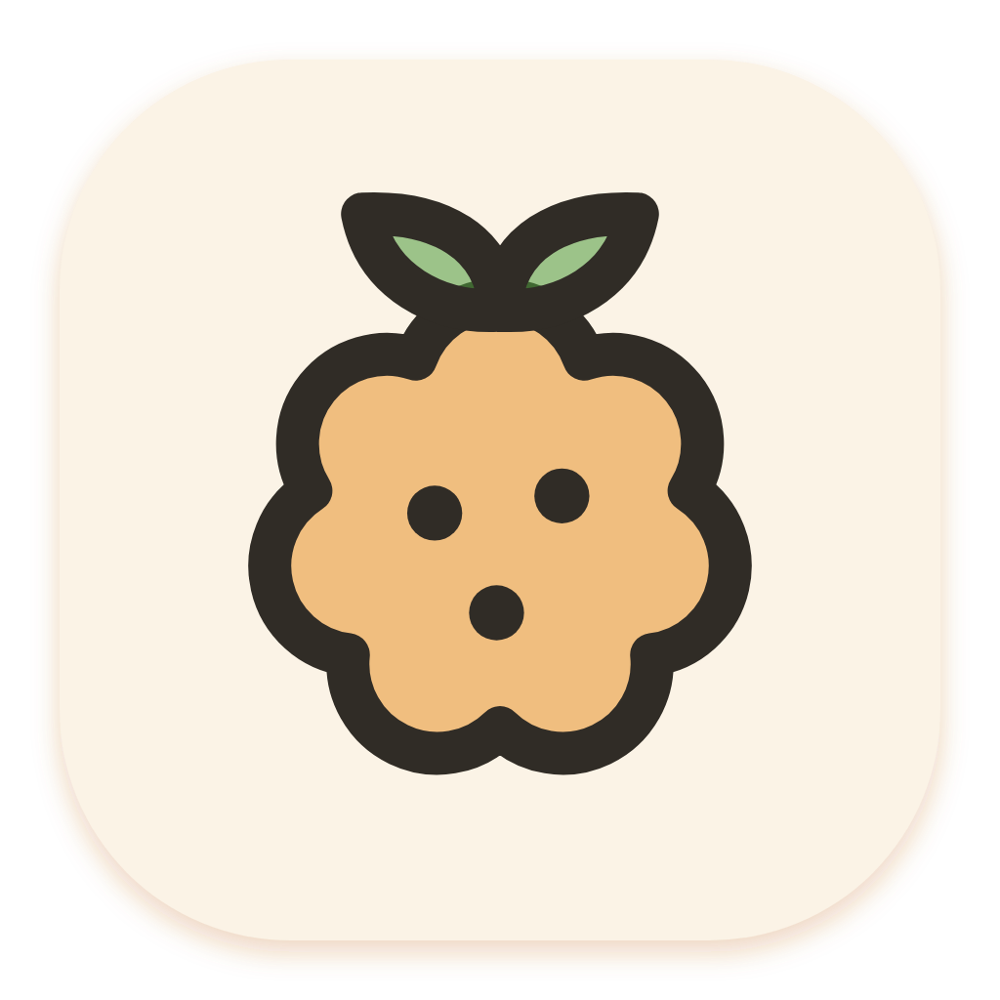
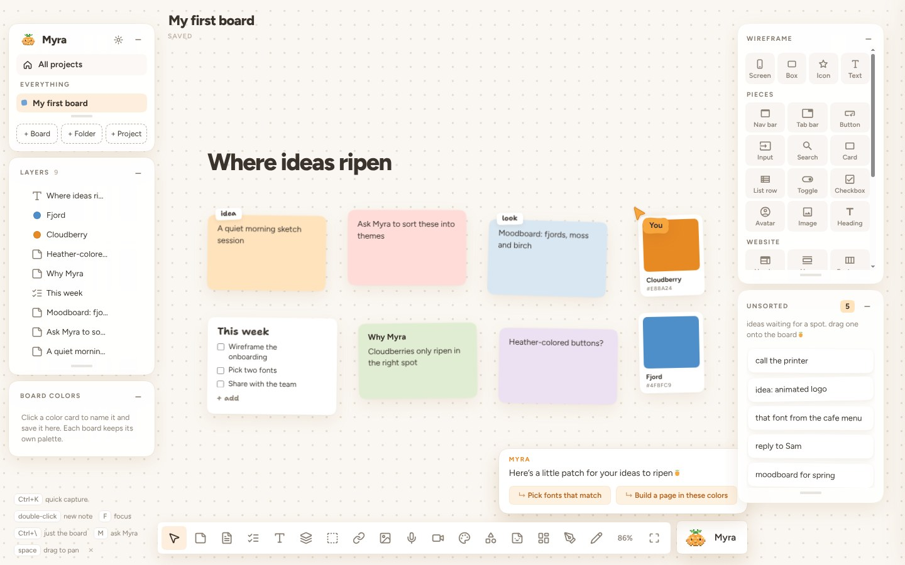

<p align="center"></p>

<h1 align="center">Fenmyr</h1>
<p align="center"><b>Where ideas thrive.</b><br>
Like cloudberries, ideas only grow where conditions are just right.<br>Fenmyr is a canvas that tries to be that place, with Myra the cloudberry to help.</p>
<p align="center"></p>

---

Fenmyr is a free, open-source canvas for ideas. It starts on Linux, with other systems and a rapid-prototyping area planned. Drop notes, pictures, links, checklists and colors on an endless board, arrange them however makes sense to *you*, and ask Myra (a little pixel cloudberry who thinks with Claude Code) to sort, plan, explore and build. Made for Arch / CachyOS and Wayland, and at home on Hyprland, KDE Plasma, GNOME, Sway and niri.

## What's inside

**The canvas**
- 🗺️ Infinite board. Pan with two fingers, pinch to zoom, cards tilt a little like paper (or sit straight, your call).
- 🗒️ Notes, titles, checklists, docs, collections, links, images (with crop), voice memos that write themselves out, videos, colors that name themselves, shapes, stamps, drawing, the Pen, squiggly lines and curvy connectors.
- 🧠 ADHD-friendly: **Ctrl+K** drops an idea into **Unsorted** without losing your place, and **F** focuses on just what you're working on.
- 📐 Wireframes: screens, boxes, text and icons, plus ready-made elements (buttons and inputs, dropdowns, tables, modals, nav and tab bars, cards…) and full layouts (hero, features, pricing, card grids…). The panel has groups that fold, and a search that understands words like “dialog” or “FAQ”. With alignment guides and strokes.
- 🗂️ Projects, folders and boards, with a home page for all of them. Move the sidebar widgets wherever you like.
- 🌙 Light and dark mode, or your [Caelestia](#follow-your-caelestia-theme) colors. Undo (Ctrl+Z), and export any card or board as an image or PDF. Docs download as PDF or Word.
- 🎨 Nordic colors for your cards: Snow, Cloudberry, Lingonberry, Moss, Fjord, Heather and Birch.

**Myra**
- 💬 Chat with her about your board. She can add, edit, sort and connect cards, make collections and folders, and always suggests a few things to do next.
- 🔤 Ask her to explore fonts and she puts real type specimens on the board, from your computer or Google Fonts.
- 📱 Describe a flow and she builds real wireframe screens. Ask for a landing page and she builds a full page in your colors and fonts.
- ✏️ In a doc, select some words and she rewrites them: shorter, friendlier, or anything you ask.

**Her helpers (optional)**, using the connections in your Claude account:
- **Mobbin** for real app screens as inspiration.
- **Higgsfield** to fill image spots with real pictures. It costs credits, so Myra always shows the price and your balance first and waits for your yes. That check can't be turned off.
- No Higgsfield? Myra can draw simple illustrations for free, or leave the spots as labeled placeholders.

## Install

### From the code (recommended on Arch / CachyOS)

```bash
git clone https://github.com/chiangs/fenmyr.git
cd fenmyr
./install.sh
```

The installer:
1. Uses Arch's `electron` package for the window (it offers to `sudo pacman -S electron` if it's missing). On other distros, or if you say no, it downloads a private copy of Electron instead.
2. Puts Fenmyr in `~/.local/lib/fenmyr`, the `fenmyr` command in `~/.local/bin`, and an entry in your app launcher.
3. Opens it. The first time, Myra walks you through setup and a short tour.

After that, Fenmyr checks for new versions on its own. When one is ready, a little dot shows on the ⚙ and Settings lists what's new, with an **Update now** button (it pulls from GitHub, reinstalls and reopens; your boards are never touched). From a terminal: `./install.sh --update`.

The installer builds Fenmyr, so it also needs Node.js and npm (it offers to `sudo pacman -S nodejs npm` if they're missing).

Installer options: `--update` (pull first), `--yes` (no questions), `--no-open`.

### AppImage

**[⬇ Download the latest AppImage](https://github.com/chiangs/fenmyr/releases/latest)** (`Fenmyr-x86_64.AppImage`)

```bash
chmod +x Fenmyr-x86_64.AppImage
./Fenmyr-x86_64.AppImage
```

AppImages need FUSE 2 (`sudo pacman -S fuse2` on Arch). The AppImage updates itself from GitHub Releases: say yes once and new versions slip in when you quit. To add it to your app launcher, use [Gear Lever](https://flathub.org/apps/it.mijorus.gearlever) or AppImageLauncher, or keep it in `~/Applications`.

### Uninstall

```bash
./uninstall.sh            # removes the app, then asks before touching your boards
./uninstall.sh --purge    # also deletes your boards and settings
```

It removes everything `install.sh` added (and any `~/Applications/Fenmyr*.AppImage`). Electron from pacman stays, since other apps may use it: `sudo pacman -Rs electron`.

## Connect Claude Code

Myra thinks with [Claude Code](https://docs.claude.com/en/docs/claude-code) on your computer. Without it the whole canvas still works; Myra just can't do the AI parts.

1. Install it: `curl -fsSL https://claude.ai/install.sh | bash` (or see the [setup guide](https://docs.claude.com/en/docs/claude-code/setup)).
2. Run `claude` once in a terminal and sign in with your Claude account.
3. Back in Fenmyr, open the ⚙ → **Helpers**. Claude Code shows **ready** as soon as Fenmyr finds it (no restart needed).

Fenmyr looks for `claude` in `~/.local/bin`, `~/.claude/local`, `/usr/bin`, `/usr/local/bin`, npm / nvm / volta / bun folders, and finally asks your login shell (bash, zsh or fish).

**Hooks.** Myra's requests always run with your Claude Code hooks switched off, so hooks meant for your own sessions (for example a desktop pet's thinking meter) don't fire while she thinks in Fenmyr. Skills, plugins, connectors and your login work as usual.

**The web.** Off by default. Turn on **Settings → Helpers → Let Myra search the web** and she can look things up and read public pages, including public GitHub repositories. What she searches for can include words from your board.

**Mobbin and Higgsfield** are connectors in your Claude account: add them at [claude.ai/settings/connectors](https://claude.ai/settings/connectors). Myra sees them through `claude mcp list`.

## Voice memos written out (optional)

Fenmyr writes out voice memos on your computer with [whisper.cpp](https://github.com/ggml-org/whisper.cpp):

```bash
yay -S whisper.cpp      # or build it yourself; Fenmyr looks for whisper-cli
```

The first memo downloads the speech model (about 140 MB, once) into `~/.local/share/fenmyr/whisper`. To use a different size, set `FENMYR_WHISPER_SIZE=tiny|base|small|medium`, or point `FENMYR_WHISPER_MODEL` at a model file you already have. Without whisper.cpp, memos still record and play.

## Your stuff

- Each board is one JSON file in `~/.local/share/fenmyr/boards`, with your folders in `folders.json` and pictures and videos in `media/`. They're ordinary files, so you can back them up or copy them like any others. Fenmyr itself needs no account and uses no cloud.
- App settings (your name, theme, the tour) live in `~/.config/Fenmyr`.
- **Keep a history of your boards.** Because boards are ordinary files, you can turn the Fenmyr folder into a git repository to keep every version. That works entirely on your computer, with no GitHub or other remote needed. Run this once:
  ```
  cd ~/.local/share/fenmyr
  printf 'whisper/\nwindow.json\nusage.json\n*.tmp\n' > .gitignore
  git init && git add -A && git commit -m "My boards"
  ```
  Then commit now and then. If you also want an off-computer backup, add a remote (for example a GitHub repository) and push; make it a private repository: boards can hold your notes and pictures. Pictures are saved inside each board's file, so boards with many large pictures make a big repo (the speech model and settings that belong to one computer are left out above; you may want to add `media/` too, since it holds videos). To keep boards in step between computers, a synced folder such as Syncthing or Nextcloud suits better than git.
- Myra only thinks when you ask her something. Then the board and your question go to Claude Code on your computer, the same as asking Claude yourself.
- Switch Myra's thinking off in Settings and the whole canvas still works, with no AI and no internet. (Spell check is Chromium's: it fetches its dictionary from Google once, then works offline.)
- Fenmyr can use your camera and microphone without asking each time (Linux has no per-app prompt like macOS). It only turns them on when you press Start recording on a voice memo or video card.
- Chats are kept the way you choose: on each board, until you quit, or not at all.

## Shortcuts

| | |
|---|---|
| **Ctrl+K** | Quick capture into Unsorted |
| **Ctrl+F** | Find on the board: opens Myra's chat with `/find` ready (works without AI); the find bar then lets you edit the search and step through matches (Enter, Shift+Enter, Esc) |
| **double-click** | New note |
| **N · C · T · D · G** | Note, checklist, title, doc, collection |
| **V** | Select |
| **L · I · A · Shift+V** | Link, image, voice memo, video |
| **S · E · P · Shift+P** | Shapes, stamps, draw, the Pen |
| **R · X** | Wireframe box, wireframe text |
| **M** | Ask Myra |
| **F** | Focus on the selection |
| **0** | Fit the whole board |
| **Ctrl + scroll** | Zoom in even steps (…90 · 100 · 110 · 125…%). A touchpad pinch zooms smoothly |
| **Ctrl + / Ctrl −** | Zoom in / out, the same steps |
| **Shift+1** | Zoom to fit |
| **Ctrl+0** | Back to 100% |
| **click the zoom %** | Zoom menu: in, out, 100%, fit, 50 / 100 / 200% |
| **Ctrl+] / Ctrl+[** | Bring forward / send backward (add Shift: all the way) |
| **Alt + drag** | Drag a copy |
| **Ctrl+Z / Ctrl+Shift+Z** | Undo / redo |
| **Ctrl+G / Ctrl+Shift+G** | Group / ungroup, so things move together |
| **Ctrl+C / Ctrl+X / Ctrl+V** | Copy, cut and paste cards, even onto another board |
| **Ctrl+\\** | Just the board (hide the panels) |
| **space + drag** | Pan |
| **Ctrl+,** | Settings |
| **Ctrl+Q · F11** | Quit · full screen |

## The window

The board fills the window, with no title bar. Move it and resize it the way your compositor does (Hyprland, Sway and niri place it like any other window). If you'd like close, minimize and maximize buttons, switch on **Settings → General → Window buttons**: three small neutral dots at the top left, with a strip next to them to drag the window by.

## Follow your Caelestia theme

If you use the [Caelestia](https://github.com/caelestia-dots/shell) Hyprland shell, Fenmyr can take on your desktop's colors and change with them.

**It's on by default** when Caelestia is installed: Settings (⚙) → General → under *Look*, **Follow Caelestia** (the switch only shows up with Caelestia). While it's on, the Theme buttons and Settings → Board → Colors are dimmed, because Caelestia decides them. Switch it off and your own colors and theme come back.

**What changes:**

| In Fenmyr | Comes from Caelestia's |
|---|---|
| Board background | `surface` |
| Grid dots | `outlineVariant` |
| Panels (sidebar, tray, toolbar, menus) | `surfaceContainer` |
| Accent (buttons, selection, highlights) | `primary` |
| Light or dark | the scheme's mode |

Card colors (your notes' butter, mint, lilac…) are part of your boards and stay as they are. Text greys, the cursor, switches and Myra keep Myra's own colors.

**Which Caelestia actions restyle it** (within about a second, no restart):

| Caelestia | Fenmyr |
|---|---|
| **Scheme** | New colors |
| **Variant** | New shades of the same scheme |
| **Light / Dark** | Switches mode too (the easiest way to see it working) |
| **Wallpaper / Random** | New colors only with the **dynamic** scheme (colors from the wallpaper). A named scheme like gruvbox or catppuccin keeps its colors whatever the wallpaper. |

Changing between two *dark* schemes mostly shows in the accent, panels and dots, since most dark backgrounds are close to black. A board with its own background (right-click a board → background) keeps it; the rest still follows.

Fenmyr reads `~/.local/state/caelestia/scheme.json`, the file Caelestia's shell and `caelestia scheme set` keep up to date, so there's nothing to set up.

## Troubleshooting

- **Blank or flickering window on NVIDIA.** Put extra Electron flags in `~/.config/fenmyr-flags.conf`, one per line, e.g. `--disable-gpu-compositing` or `--ozone-platform=x11`.
- **Force Wayland or X11.** The launcher passes `--ozone-platform-hint=auto` (Wayland when available). Add `--ozone-platform=wayland` or `--ozone-platform=x11` to the flags file to choose.
- **Camera or microphone not found.** Fenmyr uses the same camera and microphone as your browser (PipeWire). Check `pavucontrol` or your sound settings, and that nothing else holds the camera.
- **Myra says she needs Claude Code** even though it's installed: run `which claude` in a terminal and make sure that folder is one of the places listed above, or symlink it into `~/.local/bin`.
- **Follow Caelestia doesn't change anything.** Check that the switch is on (Settings → General → Follow Caelestia), then switch Caelestia to Light: the board should turn light within a second. If it doesn't, press F12 in Fenmyr and run `Fenmyr.caelestia().then(s => console.log(s && s.name, s && s.mode, '|', document.body.className))` in the Console. You should see your scheme's name and `following-caelestia`; if the name is missing, check that `~/.local/state/caelestia/scheme.json` exists.
- **Developer tools:** F12 or Ctrl+Shift+I.

## How it's built

Two layers:

- `src/web/` and `web/`: the canvas, TypeScript modules plus HTML and CSS.
- `src/host/`: a small TypeScript Electron host that does what a web page can't. It saves boards, fetches link previews, exports images and PDFs, writes out voice memos, and runs `claude -p` so Myra can think.

The two talk through one channel (`window.fenmyrHost`), so the canvas doesn't know or care which computer it's on. See [CONTRIBUTING.md](CONTRIBUTING.md) to change or extend it.

To work on the canvas in a browser, run `python3 -m http.server` inside `web/` (Myra is pretend there). To run the app from the code without installing: `npm install && npm start`.

Icons are [Phosphor Icons](https://phosphoricons.com) (MIT), plus Fenmyr's own cloudberry icons. Fonts are Figtree and Shantell Sans (OFL).

## Where Fenmyr came from

Fenmyr's code grew from [Mochiboard](https://github.com/jessawolfe-ux/mochiboard) by [Jessa Wolfe](https://jessa.art), an open-source planning canvas for the Mac (MIT). Thank you, Jessa. Mochiboard's name, its character Mochi, its stamps, art and music are hers; they aren't part of Fenmyr, and Fenmyr doesn't use them.

## License

The code is open source under the [MIT License](LICENSE). The names **Fenmyr** and **Myra**, Myra the cloudberry, her art, their own icons, the stamps, the logo and the app icon are all rights reserved by Stephen Chiang; see [TRADEMARKS.md](TRADEMARKS.md). Fenmyr also includes software made by others (Mochiboard, Electron, Material Icons, Figtree and Shantell Sans, and the libraries inside the docs editor); every one is listed with its license in [THIRD-PARTY-NOTICES.md](THIRD-PARTY-NOTICES.md), and in the app under **Settings → About → View licenses**.

---

<p align="center">Made with care by Stephen Chiang. Where ideas thrive.</p>
