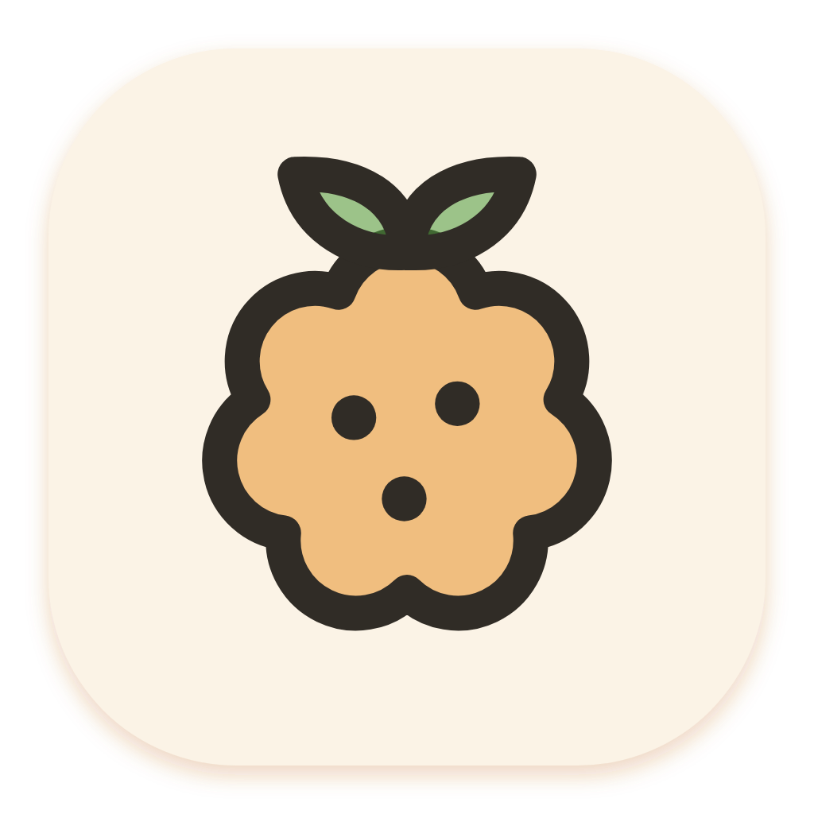
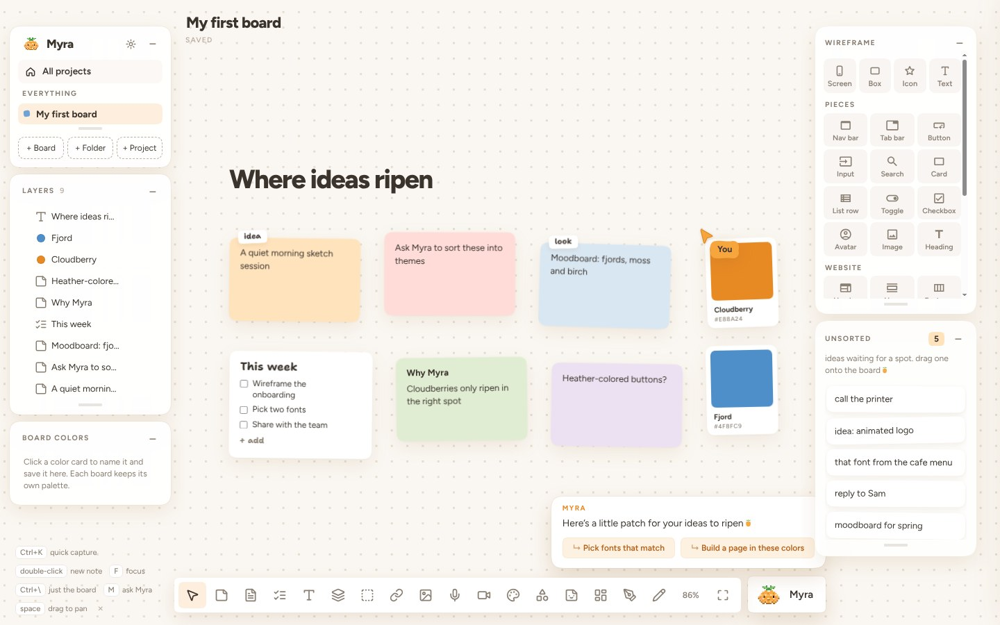
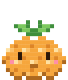
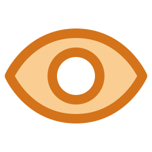
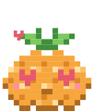
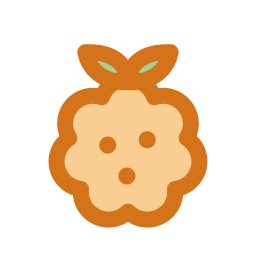

<p align="center">
  
</p>

<h1 align="center">Fenmyr</h1>

<p align="center"><b>Where ideas thrive.</b><br>
A canvas for growing ideas, from the first note to a working prototype, with Myra the cloudberry to help.</p>

<p align="center">
  <a href="https://github.com/chiangs/fenmyr/releases"></a>
  <a href="https://github.com/chiangs/fenmyr/actions/workflows/ci.yml"></a>
  <a href="LICENSE"></a>
  
  <a href="https://github.com/sponsors/chiangs"></a>
</p>

<!-- 📸 S1: replace this cover with a <picture> holding assets/readme/hero-light.png and hero-dark.png. -->
<p align="center"></p>



Fenmyr is a free, open-source canvas for Linux and the Mac. Spread notes, pictures, links, checklists, docs and wireframes across an endless board, then ask Myra, a pixel cloudberry who thinks with Claude Code on your computer, to sort, plan and build. When an idea is ready, a prototype board turns its cards into a working app, kept in your own git repo.

Your boards are plain files on your computer. Fenmyr needs no account, and its AI is optional: it runs only when you ask.

**[Why Fenmyr](#why-fenmyr)** · **[Features](#features)** · **[Install](#install)** · **[Updates and the beta](#updates-and-the-beta)** · **[Connect Claude Code](#connect-claude-code)** · **[Your data](#your-data)** · **[Docs](#documentation)** · **[Contributing](#contributing)** · **[Support](#support-fenmyr)**

## Why Fenmyr

###  From idea to prototype

<!-- 📸 S2: a prototype board with the preview at a phone width and the code pane open. 🎞 Better: a 5–8 s GIF of Point opening the code behind a button. -->

Make a board into a prototype board, and Myra builds a working React and Tailwind app from its cards through Claude Code. Each prototype board keeps its own rules and design cards, and every build reads them.

- **See it run.** The preview sits beside the board at any device width. Controls above it change the prototype's values live.
- **Read the code.** The code pane lists every file and marks what the last build changed. **Point** at anything in the preview to open the line that draws it, and code links back to the cards it came from.
- **Keep what works.** Every build can be undone. A capture puts a picture of the preview on the board, tied to the commit it shows.
- **Git, explained.** The code lives in your project's own repo, under `prototypes/`. The git bar commits, pushes and pulls, and a project can link to a GitHub repo or make one. Myra explains each git step in plain words, and waits for your yes before she installs a package, commits, pushes or pulls.

###  Myra shows her work

<!-- 📸 S3: a reply showing what changed with its Undo, the "Myra sees" strip, and a dashed plan on the board behind. -->

Myra reads your board and answers in the chat beside it.

- **Myra sees** shows what she will read, and **+ Add** hands her pictures, text files or vault notes.
- Before she changes more than ten cards, or removes any, she draws her plan on the board in dashed lines and waits.
- After a reply she lists what changed, with **Show on board** and one **Undo** for the whole reply. The notes and pages she read come back as links.
- Type **/** for commands that need no AI at all: `/find`, `/tag`, `/tidy`, `/due`, `/timer`, `/template`, `/board` and more.

###  Yours, on your computer

- Each board is one JSON file under `~/.local/share/fenmyr`. There's no account and no Fenmyr cloud.
- Switch Myra's thinking off, and the canvas works with no AI and no internet.
- Connect an Obsidian vault read-only, and choose which projects and boards may read it. Folders you put off-limits and `#private` notes are never read.
- Export a board, a folder or a whole project as a zip, and open it on another computer.
- When Myra builds, Claude Code works in the prototype's folder with file tools only: no shell and no web. Besides that folder, it reads only what the build hands it, such as pictures of the cards.

###  Made for the Linux desktop

Fenmyr is built for Arch and CachyOS on Wayland, and runs on Hyprland, KDE Plasma, GNOME, Sway and niri. The board fills a window with no title bar, so your compositor's tiling works as it does for any other window. On the [Caelestia](docs/caelestia.md) shell it takes on your desktop's colours and changes with them. It runs on the Mac too.

###  Accessible by design

<!-- 📸 S4: the same small board in all six themes, as a 3×2 grid. 📸 S5: a close-up in Clear with colour names, outlined cards and the focus ring. -->

- Six themes, three for each mode: Default, Midsummer and Clear for light, and Default, Polar Night and Lantern for dark.
- Clear and Lantern hold AAA contrast and outline every card. They also print each note's colour name, sit cards straight and thicken the focus ring, and each of those has a switch under Settings → Appearance → Accessibility.
- Cards are named by their colour for screen readers, and F10 takes the keyboard to the bar over the selection. Every shortcut is listed in [Keyboard shortcuts](docs/shortcuts.md).

###  Built to last

Each of Fenmyr's rules comes with the check that enforces it.

- **Strict TypeScript.** No `any`. Data from disk, the network and other processes is checked where it enters.
- **One bridge.** The canvas and the host meet only through a typed contract, and a check fails if either imports the other.
- **A budget that only goes down.** Casts, long files, raw colours and fixed sleeps in tests are counted, and CI fails if a count rises.
- **Tests that wait on the page.** About 280 headless Electron test files run on every pull request, and a nightly run delays every animation to catch a test that guesses at timing.
- **Proof, not promises.** Every pull request compares the app's screens pixel by pixel with the base branch. A benchmark times opening, dragging, zooming and editing a 500-card board, and measures memory, against `main`.

[](https://code-map.fenmyr.com/)

The [code map](https://code-map.fenmyr.com/) shows every source file and every import, with a line on what each file is for. It's rebuilt on every merge.

## Features

**On the board**

- Notes with formatting, links, tags and due dates; titles, checklists, docs, collections, kanbans, sections, and canvases (a board inside a board).
- Links with previews, images with crop, voice memos written out on your computer, videos, colours, shapes, stamps, drawing, the Pen and curved connectors.
- Wireframes: press **W** and pick a device for a screen, then add parts from the **Pieces** picker beside it.
- **Ctrl+K** drops an idea into Unsorted without losing your place, **Ctrl+F** finds anything a card shows, and **F** focuses on what you're working on.
- Templates (**Alt+T**), including Kanban, OKRs and opportunities, Product kickoff and Workshop planning, and your own.
- Projects, folders and boards, with a home page for each. **+ Project** asks whether its first board starts blank, as the example board or from a template.
- Export any card or board as an image or PDF, and docs as PDF or Word.

**The layout**

- The tools sit in a panel at the top right, and the bottom bar holds zoom and Ask Myra.
- A bar floats over whatever you select, with what you can do to it.
- Widgets for layers, board colours, Unsorted and zoom, placed on either side. Settings → Layout → Widgets turns each on or off.

**Myra**

- She adds, edits, sorts and connects cards, and makes collections, boards, folders and projects from plain words.
- She explores fonts with type specimens from your computer or Google Fonts, sketches a flow you describe as wireframe screens, and builds a landing page in your colours and fonts.
- She rewrites the words you select in a doc, sets timers, and reminds you of due dates, even for notes on other boards.
- You choose her model and effort, how chatty she is, and how much she moves.
- Optional helpers through your Claude account: web search, **Mobbin** for real app screens, and **Higgsfield** for generated pictures. Higgsfield costs credits, so Myra always shows the price and your balance and waits for your yes, and that check can't be turned off.

## Install

You need **Node.js 22.18 or newer** to install from the code (the installer offers to install it), and **[Claude Code](#connect-claude-code)** for Myra and prototyping.

**From the code** (recommended on Arch and CachyOS, and on a Mac):

```bash
git clone https://github.com/chiangs/fenmyr.git
cd fenmyr
./install.sh
```

On Linux this puts Fenmyr in `~/.local/lib/fenmyr` with an entry in your app launcher. On a Mac it builds `Fenmyr.app` and puts it in Applications, so macOS opens it with no warning. The first time, Myra walks you through setup and a short tour.

**AppImage** (any x86-64 Linux, needs FUSE 2): **[download the latest](https://github.com/chiangs/fenmyr/releases/latest)**, then:

```bash
chmod +x Fenmyr-x86_64.AppImage
./Fenmyr-x86_64.AppImage
```

[Installing Fenmyr](docs/install.md) has the installer's options, a downloaded `.dmg`, and uninstalling.

## Updates and the beta

Fenmyr checks for new versions on its own. When one is ready, a dot shows on the ⚙, and Settings → About lists what's new with **Update now**, which rebuilds and reopens without touching your boards.

An install from the code chooses its channel in **Settings → About → Channel**:

| Channel | What you get |
|---|---|
| **Stable** | Tested releases |
| **Beta** | New things early, with some rough edges. Stable releases come too |
| **Every change** | Each change as it's merged into `main`. For people working on Fenmyr |

An AppImage follows Stable only. A copy from a `.dmg` doesn't update.

### Try the beta

1. [Install from the code](#install).
2. Choose **Beta** in Settings → About → Channel, then **Update now**.
3. Found something? [Report it](https://github.com/chiangs/fenmyr/issues/new/choose), and paste in what **Copy details** in Settings → About gives you.

Going back to Stable keeps the beta you have until a newer stable release arrives. A card that an older Fenmyr can't read is kept as it is when you save.

## Connect Claude Code

Myra thinks with [Claude Code](https://docs.claude.com/en/docs/claude-code) on your computer. Without it, the canvas still works, but Myra can't do the AI parts.

1. Install it: `curl -fsSL https://claude.ai/install.sh | bash`, or see the [setup guide](https://docs.claude.com/en/docs/claude-code/setup).
2. Run `claude` once in a terminal and sign in with your Claude account.
3. In Fenmyr, open Settings → Connections. Claude Code shows **ready** as soon as Fenmyr finds it.

Myra's requests run with your Claude Code hooks off, so hooks meant for your own sessions don't fire while she thinks. Skills, plugins, connectors and your sign-in work as usual.

**More connections**, all in Settings → Connections:

- **The web** is off until you switch on **Let Myra search the web**. Her searches can include words from your board.
- **Git and GitHub** are for prototyping. Fenmyr uses `git` and the `gh` command, so it never holds a GitHub token itself.
- **Obsidian vaults** connect read-only, in three steps: connect, give access, allow AI reading.
- **Mobbin and Higgsfield** are connectors in your Claude account. Add them at [claude.ai/settings/connectors](https://claude.ai/settings/connectors).
- **Voice memos written out**: install [whisper.cpp](https://github.com/ggml-org/whisper.cpp) (`yay -S whisper.cpp`). The first memo downloads a speech model of about 140 MB. Set `FENMYR_WHISPER_SIZE=tiny|base|small|medium` for another size, or `FENMYR_WHISPER_MODEL` to a model you have. Without it, memos still record and play.

## Your data

- Boards are JSON files in `~/.local/share/fenmyr/boards`, with folders in `folders.json`, videos in `media/` and your templates in `templates/`. Back them up or copy them like any other files. App settings live in `~/.config/Fenmyr`.
- A prototype's code lives in its project's git repo, under `prototypes/`. It reaches GitHub only when you push.
- Myra thinks only when you ask her something or start a build. Then the board and your words go to Claude Code on your computer, the same as asking Claude yourself.
- Chats are kept the way you choose in Settings → Myra: on each board, until you quit, or not at all. Prototype boards always keep theirs.
- Linux has no per-app camera and microphone prompt. A voice memo or video card turns them on when you add or use it, and only Fenmyr's own window can use the microphone, clipboard and notifications.
- Chromium's spell check fetches its dictionary from Google once, then works offline.

<details>
<summary><b>Keep a history of your boards with git</b></summary>

The Fenmyr folder can be a git repository of its own, on your computer only. Run this once:

```bash
cd ~/.local/share/fenmyr
printf 'whisper/\npending-update/\nwindow.json\nusage.json\nupdate.log\n*.tmp\n' > .gitignore
git init && git add -A && git commit -m "My boards"
```

Then commit now and then. For a backup off your computer, add a private remote, since boards can hold your notes and pictures. Pictures are saved inside each board's file, so boards with many large pictures make a big repository; you may also want to ignore `media/`, which holds videos. To keep boards in step between computers, a synced folder such as Syncthing or Nextcloud suits better than git.

</details>

## Documentation

| | |
|---|---|
| [Keyboard shortcuts](docs/shortcuts.md) | Every key, written from the app's own tables |
| [Installing Fenmyr](docs/install.md) | Every way in, the installer's options, updates and uninstalling |
| [Follow your Caelestia theme](docs/caelestia.md) | What Fenmyr takes from Caelestia, and what it follows |
| [Troubleshooting](docs/troubleshooting.md) | NVIDIA, Wayland and X11, Claude Code not found, updates |
| [What's new](WHATSNEW.md) | Each version's changes |
| [Contributing](CONTRIBUTING.md) | How the code is laid out and how to change it |
| [Design](DESIGN.md) | The visual and copy rules |

## Contributing

Fenmyr is TypeScript on Electron: `src/web/` draws the canvas and `src/host/` owns files, programs and the network. To run it from a checkout:

```bash
npm ci && node node_modules/electron/install.js && npm start
```

Run `npm run check:fast` before each commit. [CONTRIBUTING.md](CONTRIBUTING.md) explains the rest. Bugs and ideas are welcome through the [issue forms](https://github.com/chiangs/fenmyr/issues/new/choose).

## Support Fenmyr



Fenmyr is free and made in spare hours. If it helps you think, you can help it grow:

- **[Sponsor on GitHub](https://github.com/sponsors/chiangs)**
- Star the repository, so others find it.
- Try the beta and report what breaks.


## Credits

Fenmyr began as a fork of [Mochiboard](https://github.com/jessawolfe-ux/mochiboard) 1.7.3 by [Jessa Wolfe](https://jessa.art), an open-source planning canvas for the Mac (MIT), in October 2026. Thank you, Jessa. Mochiboard's name, its character Mochi, its stamps, art and music are hers, and Fenmyr doesn't use them.

Icons are [Phosphor Icons](https://phosphoricons.com) (MIT), plus Fenmyr's own cloudberry icons. Fonts are Figtree and Shantell Sans (OFL). Voice memos are written out by [whisper.cpp](https://github.com/ggml-org/whisper.cpp).

## Licence

The code is open source under the [MIT License](LICENSE). The names **Fenmyr** and **Myra**, Myra the cloudberry, her art, their own icons, the stamps, the logo and the app icon are all rights reserved by Stephen Chiang; see [TRADEMARKS.md](TRADEMARKS.md). Fenmyr also includes software made by others. Each is listed with its licence in [THIRD-PARTY-NOTICES.md](THIRD-PARTY-NOTICES.md), and in the app under Settings → About → **View licences**.

---

<p align="center"><br>Made with care by Stephen Chiang. Where ideas thrive.</p>
